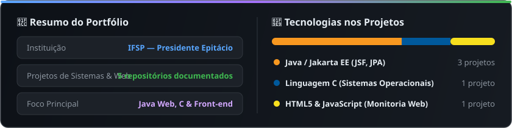

# Tobias Rafael

### Estudante de Computação no IFSP, Campus Presidente Epitácio

*Repositório dos meus estudos, projetos web e conteúdos pessoais.*

---

## Sobre mim

Sou estudante de Ciência da Computação no IFSP (Campus Presidente Epitácio). Criei este perfil para reunir projetos da faculdade, exercícios práticos e aplicações web que desenvolvo.

- Desenvolvimento de sistemas web usando Java (JSF, PrimeFaces e JPA) com MySQL.
- Páginas e scripts em HTML5 e JavaScript, incluindo materiais da monitoria de Programação Web.
- Trabalhos práticos e atividades desenvolvidas ao longo do curso.

---

## Tecnologias e ferramentas

---

## Projetos

| Projeto | Descrição | Tecnologias |
| :--- | :--- | :--- |
| [**Sistema de Alocação de Desenvolvedores**](https://github.com/rtobias-git/Prova-ferramentas) | Controle de alocação de desenvolvedores em projetos com validação de horas, filtros e finalização | `Java 17` `JSF` `PrimeFaces` `JPA` `MySQL` |
| [**Sistema de Vendas com Login**](https://github.com/rtobias-git/products-selling-page-with-user-login) | Sistema de vendas com controle de acesso, filtro de produtos por categoria e fechamento de pedidos | `Java` `JSF` `PrimeFaces` `JPA` `MySQL` |
| [**Sistema de Venda de Cursos**](https://github.com/rtobias-git/course-selling-page-with-user-login) | Venda de cursos com validação de formulários e cálculo de desconto via AJAX | `Java` `JSF` `PrimeFaces` `JPA` `MySQL` |
| [**Sistema de Arquivos togabifs**](https://github.com/rtobias-git/File-system-in-C-programming) | Simulador de sistema de arquivos em C com shell próprio, árvore binária para diretórios e controle de blocos livres | `C` `Sistemas Operacionais` |
| [**Monitoria de Programação Web**](https://github.com/rtobias-git/monitoria-programa-oweb) | Exercícios práticos em HTML e JavaScript desenvolvidos durante as aulas de monitoria | `HTML5` `JavaScript` |

---

## Visão Geral

